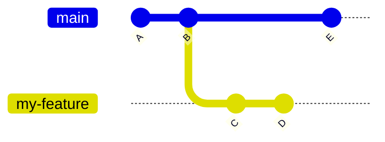
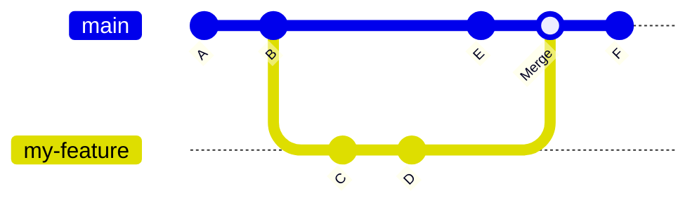
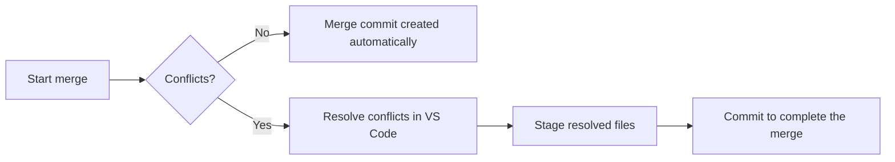
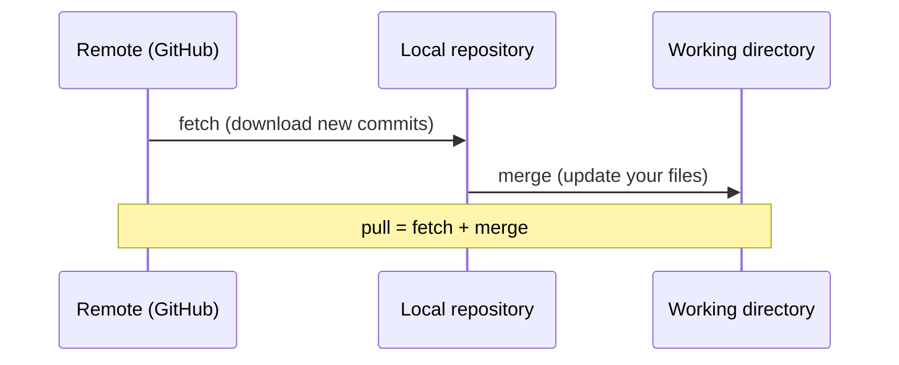

Git through VSCode description
clone, update, open issue, directory vs branch
claude use, help with merge conflicts

python, jupyter, matlab
run locally
use of env not unified
pip, uv
ML/DL code

onboarding repo / process standards

- envs
- pre-commit hooks
- work in branches
- open issues


# About git and GitHub

`git` is a version-control system: It allows you to track, document, save, and revert changes. It is extremely useful when working with code, as it allows you to browse previous versions of your code, and to document why you made this or that decision.

Using `git` is not difficult. You should however familiarize yourself with its main terminology:


A **`commit`** is a snapshot of your file system. With a `commit`, you record the current state of a file or whole directoy in the `git` history. You can always go back to a certain `commit` and restore the file system to that specific point in time. Before committing, you `stage` the changes you want to include. Each `commit` has a message that describes what changed. 

A **`repository`** contains the files that you are working on, plus some additional files that store your history. These files are hidden in the `.git` folder. The files you open and edit are in your working directory. To work on an existing project, clone its repository from GitHub or another remote Git host. To start tracking a project you already have locally, run git init in its folder.

A **`checkout`** is an action that can switch you to a different branch or let you inspect an earlier commit. You can checkout a branch, or a specific file from a branch, more below.

A **`branch`** is a named line of development in your project. It is basically an alternative state of your project to the main state of the project (usually in the `main`, or for older repos, `master` branch) and becomes the new project state once it is merged with the `main` branch. You can safely make changes in a branch without destroying the operability of the main project state.

 A `git` workflow has three stages:


A file is **modified**. You have made changes, and saved the file, but nothing else yet.

By adding the file to the staging index, you **stage** the file for a commit (more below).

You provide a **commit** message and commit the file to the local `git` history.

Usually, there is a fourth step, that is the synchronization of your local files with the remote git host (for example, GitHub). For this you need to **`push`** your changes to the remote; which makes the changes available for everyone who has access to the repository.

GitHub is a service that hosts Git repositories online so you can share your work and collaborate with others. You can use GitHub to make your projects available to a selected user group, or to the whole public. GitHub offers much more than just git hosting, through GitHub projects, GitHub pages, GitHub Copilot, Pull Requests, Continuous Integration, Continuous Deployment, ... - which goes beyond the instructions provided here. 

# Work with git and GitHub in VS Code

You will mainly use git through Visual Studio Code (VS Code). For the complete and current documentation, see [the official VS Code instructions](https://code.visualstudio.com/docs/sourcecontrol/github).

## Getting ready to use `git` and VS Code part 1

1. If you use Windows, you need to [install git](https://git-scm.com/install/windows) on your local machine first. It is pre-installed on Linux. On MacOS, you may need to install the [Xcode Command Line Tools](https://developer.apple.com/documentation/xcode/installing-the-command-line-tools).

2. The second step is to [install VS Code](https://code.visualstudio.com/download).

3. If you do not have a GitHub user account, you should [set one up](https://github.com/) and be asked to be added to your GitHub organization.

## Using VS Code

VS Code is a code editor that lets you write and debug code, run commands, and work with Git in one place. It has a primary side bar to the left, with a variety of options (from top to bottom, the important ones are highlighted in bold):
- **File explorer**, this lets you view and select files and directories
- Search functionality
- Testing functionality
- **Source control**, this is the main git functionality
- Debug functionality
- **Extensions**, by which you can customize and enhance VS Code
- GitHub functionality
- ...

## Getting ready to use `git` and VS Code part 2

First you need to install the appropriate extensions. For working with Python source code, for example, you should install Python if not installed yet and the [relevant extension](https://code.visualstudio.com/docs/languages/python).

There is also functionality for `csv` files, for example. 

You also need to connect your VS Code installation to your GitHub user account, so that it can `git commit`, `git push`, `git checkout`, ..., on your behalf. For this, click on the bottom left user icon and follow the instructions.


Once you are successfully signed in to GitHub, it should display your user image as the icon.

You also need to tell your local `git` installation your name and email, so that the `git commit`s are associated with the correct identity. For this, click on "Termina" -> "New Terminal". On Windows, make sure that VS Code has openend a "PowerShell". In the terminal, provide your `git` identity:
```bash
git config --global user.name "Ada Lovelace"
git config --global user.email "ada@example.org"
```
**Now you are ready to use `git`!**

## Cloning a repository

To clone a repository - to create a local copy of a project - click on "Source Control" in the left control panel. If you do not have any folder open, it will offer you the option to clone a repository.

You then need to provide the URL to the repository that you want to clone. This you get from the GitHub website of that repository, by clicking on the green "Code" button.

Copy the link that is shown in the **SSH** tab, if you have [set up an ssh key for your GitHub account](https://docs.github.com/en/authentication/connecting-to-github-with-ssh/adding-a-new-ssh-key-to-your-github-account); or use the **HTTPS** link if you manage your credentials locally (you may need to provide your GitHub credentials).

## Opening a local repository

To open a local repository - one that you have either cloned first, or that you have created locally - you navigate to "File" -> "Open Folder" and browse to the respective folder; then click "Open".

## Creating a new branch

publish branch
show what a branch is

A branch starts from a specific commit (usually the latest commit on `main`) and from then on records its own commits, independently of `main`. Other people can keep working on `main` (or on their own branches) at the same time without interfering with your work:



Here, `my-feature` was created from commit `B`. Commits `C` and `D` only exist on `my-feature`, while commit `E` only exists on `main`.

To create a new branch in VS Code, click on the branch name in the bottom left corner of the status bar (e.g. `main`) and select "Create new branch..." (or open the Command Palette with `Ctrl+Shift+P` and run "Git: Create Branch..."). Give the branch a short, descriptive name, for example `fix-data-loading` or `add-plotting-script`. VS Code automatically switches to the new branch.

The new branch only exists on your local machine at first. To make it available on GitHub, click "Publish Branch" in the Source Control panel (or the cloud icon next to the branch name in the status bar).

## Switching branches

To switch to another branch, click on the branch name in the bottom left corner of the status bar and select the branch you want from the list. VS Code then updates the files in your working directory to the state of that branch.

Note that a branch is *not* a separate directory: you stay in the same folder, but the contents of the files change depending on which branch you have checked out. Commit (or stash) your changes before switching, otherwise `git` may refuse to switch or carry your uncommitted changes over to the other branch.

## Merging branches

Merging brings the changes from one branch into another. Typically, once your work on a feature branch is done, it is merged back into `main`:



The merge creates a new commit on `main` that combines the changes from `my-feature` (`C`, `D`) with the changes on `main` (`E`).

In our projects, merging into `main` is usually done on GitHub through a **Pull Request**, so that others can review your changes first. To merge locally in VS Code, switch to the branch you want to merge *into* (e.g. `main`), open the Command Palette (`Ctrl+Shift+P`), run "Git: Merge..." and select the branch to merge *from*.

If both branches changed the same lines of a file, `git` cannot decide which version to keep and reports a **merge conflict**. VS Code highlights the conflicting sections and lets you choose "Accept Current Change", "Accept Incoming Change" or "Accept Both Changes", or open the merge editor to resolve them. After resolving all conflicts, stage the files and commit to complete the merge.



## Updating the local copy of the repository with the latest changes on the remote
fetch and pull

Other people push their changes to the remote while you work, so your local copy can become outdated.

- **`fetch`** downloads the latest information from the remote (new commits and branches), but does not change your files.
- **`pull`** fetches *and* merges the remote changes into your current branch.



In VS Code, click the "Synchronize Changes" icon (circular arrows) next to the branch name in the status bar, or use the "..." menu in the Source Control panel and select "Pull" or "Fetch". It is good practice to pull before you start working each day.

## Making changes to a file

Open a file from the File Explorer and edit it as usual, then save it (`Ctrl+S`). VS Code marks modified files with an **M** in the File Explorer and the Source Control panel; new, untracked files are marked with a **U**. Click on a file in the Source Control panel to see a side-by-side comparison (diff) of your changes.

## Staging the changes for a commit

In the Source Control panel, hover over a changed file and click the **+** icon to stage it, or click **+** next to "Changes" to stage all files. Staged files move to the "Staged Changes" section. Staging lets you decide exactly which changes go into the next commit, so that each commit groups related changes together. To unstage a file, click the **−** icon.

## Making a commit

Type a short, meaningful commit message into the text field at the top of the Source Control panel, for example "Fix unit conversion in data loader", and click "Commit". Good commit messages describe *what* changed and, if not obvious, *why*. If you have not staged anything, VS Code will ask whether to commit all changes directly.

## Pushing the changes to the remote

After committing, your commits only exist locally. Click "Sync Changes" in the Source Control panel (or the "..." menu -> "Push") to upload your commits to GitHub. If the remote contains changes you do not have yet, you have to pull first.

## Checking out a specific file from another branch or commit

Sometimes you only want one file in the state of another branch or an earlier commit, without switching branches entirely. In the terminal, run:
```bash
git checkout other-branch -- path/to/file.py
git checkout <commit-hash> -- path/to/file.py
```
The file in your working directory is then replaced by that version and shows up as modified, so you can review, stage and commit it. You can browse earlier versions of a file in VS Code via the "Timeline" view at the bottom of the File Explorer.

## Deleting a branch

Once a branch has been merged, it is no longer needed and can be deleted to keep the repository tidy. In VS Code, open the Command Palette (`Ctrl+Shift+P`) and run "Git: Delete Branch...". You cannot delete the branch you are currently on, so switch to `main` first. This deletes only the local branch; the branch on GitHub can be deleted via the "Delete branch" button after merging a Pull Request, or on the "Branches" page of the repository.

## Opening an issue

Issues are used on GitHub to track bugs, tasks, ideas and questions. To open one, go to the repository on GitHub, click the "Issues" tab and then "New issue". Give it a clear title and describe the problem or task, including steps to reproduce a bug if relevant. You can assign people, add labels, and reference the issue in commits or Pull Requests (e.g. "Fixes #12"), which closes the issue automatically when merged. With the "GitHub Pull Requests" extension, you can also view and create issues directly in VS Code.


