# FemtoCodeSpace onboarding and standard practice repo

This is the FemtoCodeSpace onboarding repo, that contains materials detailing the standard processes and tools used in the group. It contains sections about the [use of git and GitHub](#about-git-and-github) including [the GitHub flow we follow in the group](#the-github-flow-how-we-work-in-the-group), about [how to run Python code](#how-to-run-python-code), [code formatting, linting and pre-commit hooks](#code-formatting-linting-and-pre-commit-hooks), and about [how to set up your AI agents](#how-to-set-up-your-ai-agents) such as Claude Code.

# About git and GitHub

`git` is a version-control system: It allows you to track, document, save, and revert changes. It is extremely useful when working with code, as it allows you to browse previous versions of your code, and to document why you made this or that decision.

Using `git` is not difficult. You should however familiarize yourself with its main terminology:
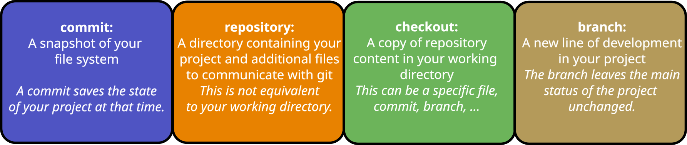

A **`commit`** is a snapshot of your file system. With a `commit`, you record the current state of a file or whole directoy in the `git` history. You can always go back to a certain `commit` and restore the file system to that specific point in time. Before committing, you `stage` the changes you want to include. Each `commit` has a message that describes what changed. 

A **`repository`** contains the files that you are working on, plus some additional files that store your history. These files are hidden in the `.git` folder. The files you open and edit are in your working directory. To work on an existing project, clone its repository from GitHub or another remote Git host. To start tracking a project you already have locally, run git init in its folder.

A **`checkout`** is an action that can switch you to a different branch or let you inspect an earlier commit. You can checkout a branch, or a specific file from a branch, more below.

A **`branch`** is a named line of development in your project. It is basically an alternative state of your project to the main state of the project (usually in the `main`, or for older repos, `master` branch) and becomes the new project state once it is merged with the `main` branch. You can safely make changes in a branch without destroying the operability of the main project state.

 A `git` workflow has three stages:
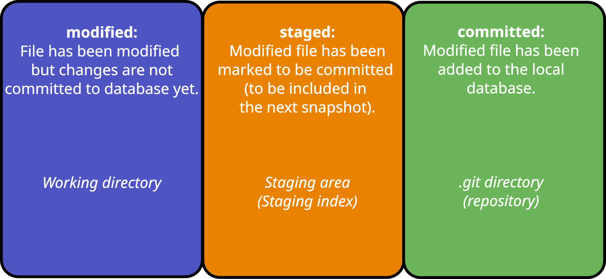

A file is **modified**. You have made changes, and saved the file, but nothing else yet.

By adding the file to the staging index, you **stage** the file for a commit (more below).

You provide a **commit** message and commit the file to the local `git` history.

Usually, there is a fourth step, that is the synchronization of your local files with the remote git host (for example, GitHub). For this you need to **`push`** your changes to the remote; which makes the changes available for everyone who has access to the repository.

GitHub is a service that hosts Git repositories online so you can share your work and collaborate with others. You can use GitHub to make your projects available to a selected user group, or to the whole public. GitHub offers much more than just git hosting, through GitHub projects, GitHub pages, GitHub Copilot, Pull Requests, Continuous Integration, Continuous Deployment, ... - which goes beyond the instructions provided here. 

## The GitHub flow: how we work in the group

All projects in the group follow the [GitHub flow](https://docs.github.com/en/get-started/using-github/github-flow). The `main` branch always contains working code; nobody commits directly to `main`. Every change ideally goes through these steps:

1. **Open an issue** on GitHub that describes the bug, task or idea (see [Opening an issue](#opening-an-issue)).
2. **Update your local `main`** with the latest changes from GitHub (see [Updating the local copy](#updating-the-local-copy-of-the-repository-with-the-latest-changes-on-the-remote)).
3. **Create a new branch** from `main` with a short, descriptive name, e.g. `fix-data-loading` (see [Creating a new branch](#creating-a-new-branch)).
4. **Make changes and commit** them to your branch in small, meaningful steps (see [Making a commit](#making-a-commit)).
5. **Push the branch** to GitHub (see [Pushing the changes to the remote](#pushing-the-changes-to-the-remote)). Push regularly, so your work is backed up and visible to others.
6. **Discuss with the project's main responsible person and ask them to merge the changes.**

The following sections explain how to do each of these steps in VS Code.

# Work with git and GitHub in VS Code

You will mainly use git through Visual Studio Code (VS Code). For the complete and current documentation, see [the official VS Code instructions](https://code.visualstudio.com/docs/sourcecontrol/github).

## Getting ready to use `git` and VS Code part 1

1. If you use Windows, you need to [install git](https://git-scm.com/install/windows) on your local machine first. It is pre-installed on Linux. On MacOS, you may need to install the [Xcode Command Line Tools](https://developer.apple.com/documentation/xcode/installing-the-command-line-tools).

2. The second step is to [install VS Code](https://code.visualstudio.com/download).

3. If you do not have a GitHub user account, you should [set one up](https://github.com/) and be asked to be added to your GitHub organization.

## Using VS Code

VS Code is a code editor that lets you write and debug code, run commands, and work with Git in one place. It has a primary side bar to the left, with a variety of options (from top to bottom, the important ones are highlighted in bold):
- **File explorer**, this lets you view and select files and directories
- Search functionality
- Testing functionality
- **Source control**, this is the main git functionality
- Debug functionality
- **Extensions**, by which you can customize and enhance VS Code
- GitHub functionality
- ...

## Getting ready to use `git` and VS Code part 2

First you need to install the appropriate extensions. For working with Python source code, for example, you should install Python if not installed yet and the [relevant extension](https://code.visualstudio.com/docs/languages/python).

There is also functionality for `csv` files, for example. 

You also need to connect your VS Code installation to your GitHub user account, so that it can `git commit`, `git push`, `git checkout`, ..., on your behalf. For this, click on the bottom left user icon and follow the instructions.

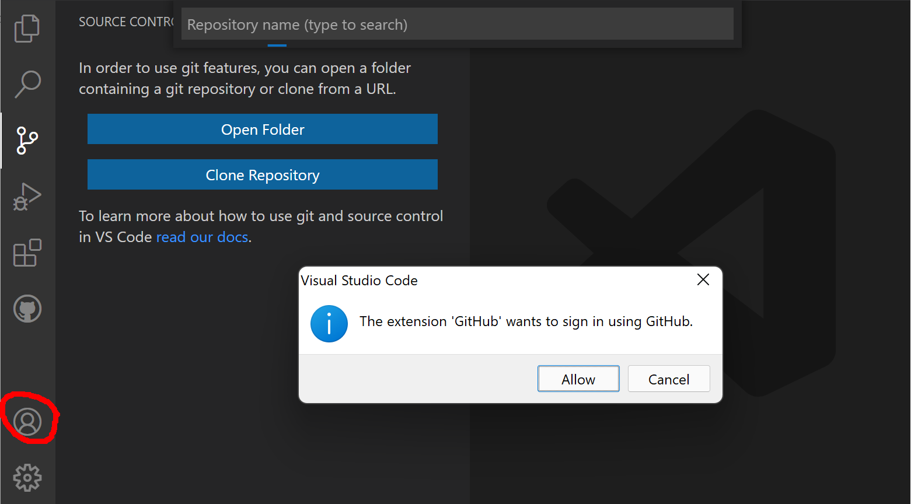

Once you are successfully signed in to GitHub, it should display your user image as the icon.

You also need to tell your local `git` installation your name and email, so that the `git commit`s are associated with the correct identity. For this, click on "Termina" -> "New Terminal". On Windows, make sure that VS Code has openend a "PowerShell". In the terminal, provide your `git` identity:
```bash
git config --global user.name "Ada Lovelace"
git config --global user.email "ada@example.org"
```
**Now you are ready to use `git`!**

## Cloning a repository

To clone a repository - to create a local copy of a project - click on "Source Control" in the left control panel. If you do not have any folder open, it will offer you the option to clone a repository.
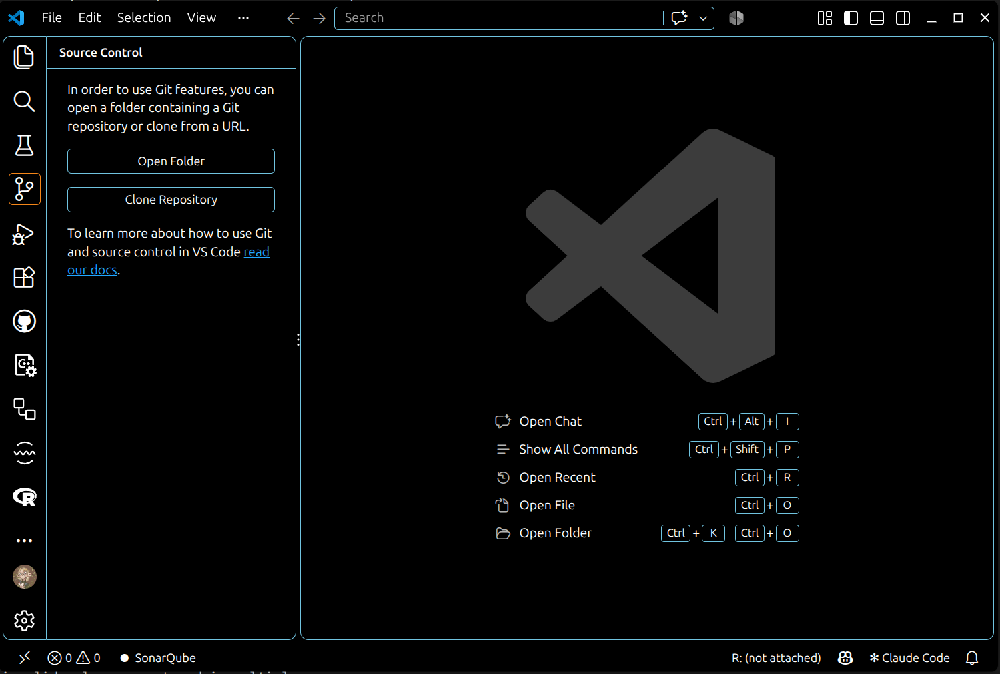
You then need to provide the URL to the repository that you want to clone. This you get from the GitHub website of that repository, by clicking on the green "Code" button.
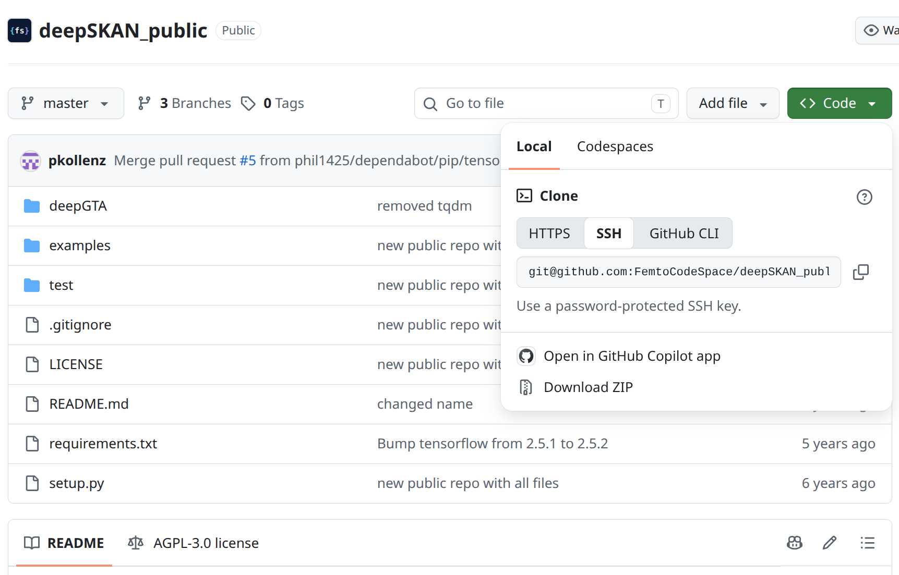
Copy the link that is shown in the **SSH** tab, if you have [set up an ssh key for your GitHub account](https://docs.github.com/en/authentication/connecting-to-github-with-ssh/adding-a-new-ssh-key-to-your-github-account); or use the **HTTPS** link if you manage your credentials locally (you may need to provide your GitHub credentials).

## Opening a local repository

To open a local repository - one that you have either cloned first, or that you have created locally - you navigate to "File" -> "Open Folder" and browse to the respective folder; then click "Open".

## Creating a new branch

A branch tracks a certain line of development, starting from some common ancestor (a certain commit, usually the latest commit on `main`). A branch records from then on its own commits, independently of `main`. Other people can keep working on `main` (or on their own branches) at the same time without interfering with your work:

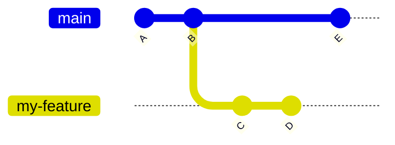

Here, `my-feature` was created from commit `B`. Commits `C` and `D` only exist on `my-feature`, while commit `E` only exists on `main`.

To create a new branch in VS Code, click on the branch name in the bottom left corner of the status bar (e.g. `main`) and select "Create new branch". Give the branch a short, descriptive name, for example `fix-data-loading` or `add-plotting-script`. VS Code automatically switches to the new branch.

The new branch only exists on your local machine at first. To make it available on GitHub, click "Publish Branch" in the Source Control panel (or the cloud icon next to the branch name in the status bar).
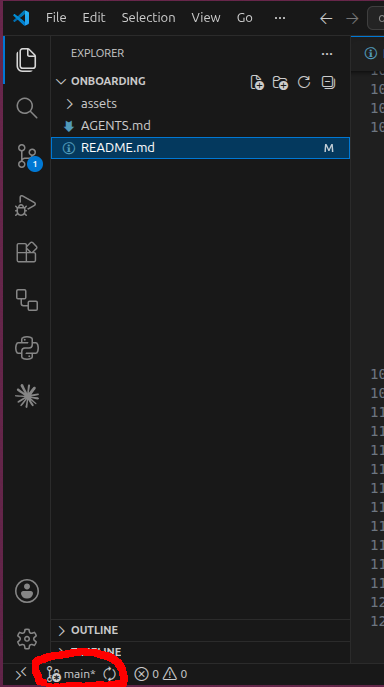

## Switching branches

To switch to another branch, click on the branch name in the bottom left corner of the status bar and select the branch you want from the list. VS Code then updates the files in your working directory to the state of that branch.

Note that a branch is not a separate directory: you stay in the same folder, but the contents of the files change depending on which branch you have checked out. If you have changes on the current branch, commit (or stash) them before switching, otherwise `git` may refuse to switch.

## Merging branches

Merging brings the changes from one branch into another. Typically, once your work on a feature branch is done, it is merged back into `main`:

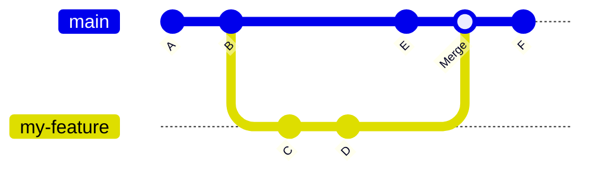

The merge creates a new commit on `main` that combines the changes from `my-feature` (`C`, `D`) with the changes on `main` (`E`).

**Depending on your project, merging into `main` may require a review from another person in the group first.**

If both branches changed the same lines of a file, `git` cannot decide which version to keep and reports a **merge conflict**. VS Code highlights the conflicting sections and lets you choose "Accept Current Change", "Accept Incoming Change" or "Accept Both Changes", or open the merge editor to resolve them. After resolving all conflicts, stage the files and commit to complete the merge.

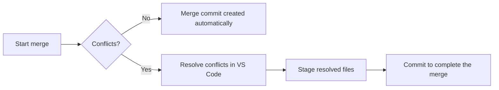
You may use Claude or another AI agent to help you resolve merge conflicts.

## Updating the local copy of the repository with the latest changes on the remote
Other people push their changes to the remote while you work, so your local copy can become outdated.

- **`fetch`** downloads the latest information from the remote (new commits and branches), but does not change your files.
- **`pull`** fetches and merges the remote changes into your current branch.

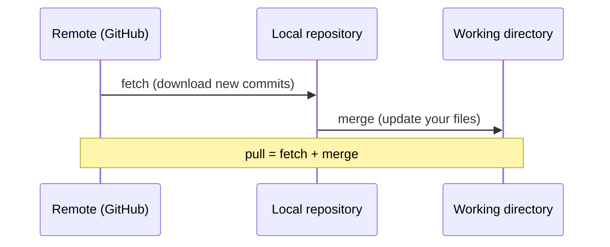

In VS Code, click the "Synchronize Changes" icon (circular arrows) next to the branch name in the status bar, or use the "..." menu in the Source Control panel and select "Pull" or "Fetch". It is good practice to pull before you start working each day.

## Making changes to a file

Open a file from the File Explorer and edit it as usual, then save it (`Ctrl+S`). VS Code marks modified files with an **M** in the File Explorer and the Source Control panel; new, untracked files are marked with a **U**. Click on a file in the Source Control panel to see a side-by-side comparison (diff) of your changes.

## Staging the changes for a commit

In the Source Control panel, hover over a changed file and click the **+** icon to stage it, or click **+** next to "Changes" to stage all files. Staged files move to the "Staged Changes" section. Staging lets you decide exactly which changes go into the next commit, so that each commit groups related changes together. To unstage a file, click the **−** icon.

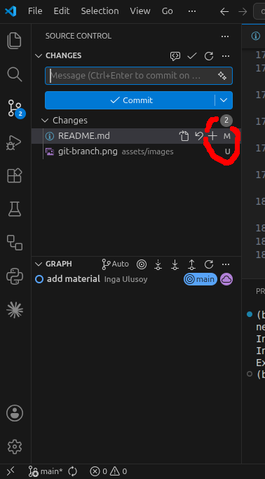

## Making a commit

Type a short, meaningful commit message into the text field at the top of the Source Control panel, for example "Fix unit conversion in data loader", and click "Commit". Good commit messages describe *what* changed and, if not obvious, *why*. If you have not staged anything, VS Code will ask whether to commit all changes directly.

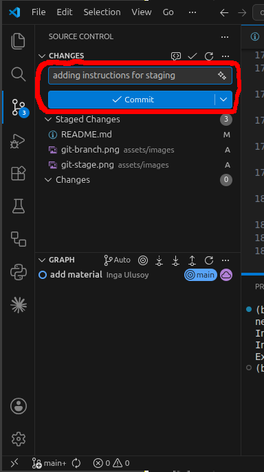

If the repository uses [`pre-commit` hooks](#pre-commit-hooks) (and you have activated them with `pre-commit install`), a set of checks such as code formatting and linting runs automatically on your staged files when you click "Commit". If a check fails or modifies a file, the commit is not created; review the changes, stage the files again and commit again. See [What happens when a hook fails](#what-happens-when-a-hook-fails) for details.

## Pushing the changes to the remote

After committing, your commits only exist locally. Click "Sync Changes" in the Source Control panel (or the "..." menu -> "Push") to upload your commits to GitHub. If the remote contains changes you do not have yet, you have to pull first.

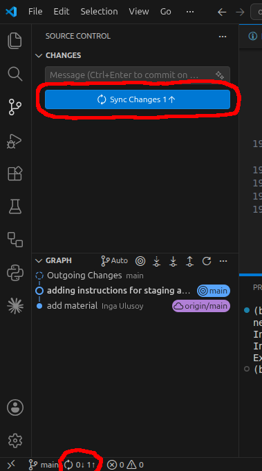

## Checking out a specific file from another branch or commit

Sometimes you only want one file in the state of another branch or an earlier commit, without switching branches entirely. In the terminal, run:
```bash
git checkout other-branch -- path/to/file.py
git checkout <commit-hash> -- path/to/file.py
```
The file in your working directory is then replaced by that version and shows up as modified, so you can review, stage and commit it. You can browse earlier versions of a file in VS Code via the "Timeline" view at the bottom of the File Explorer.

## Deleting a branch

Once a branch has been merged, it is no longer needed and can be deleted to keep the repository tidy. In VS Code, open the Command Palette (`Ctrl+Shift+P`) and run "Git: Delete Branch...". You cannot delete the branch you are currently on, so switch to `main` first. This deletes only the local branch; the branch on GitHub can be deleted via the "Delete branch" button after merging a Pull Request, or on the "Branches" page of the repository.

## Opening an issue

Issues are used on GitHub to track bugs, tasks, ideas and questions. To open one, go to the repository on GitHub, click the "Issues" tab and then "New issue". Give it a clear title and describe the problem or task, including steps to reproduce a bug if relevant. You can assign people, add labels, and reference the issue in commits or Pull Requests (e.g. "Fixes #12"), which closes the issue automatically when merged. With the "GitHub Pull Requests" extension, you can also view and create issues directly in VS Code.

# How to run Python code
The FemtoCodeSpace group mostly runs Python code, and predominantly through Jupyter notebooks; but also Matlab code. Here some instructions for how to run Python code locally are provided.

## Python environments
You should use Python environments to handle different Python packages or notebooks. The reason is that different packages can have conflicting dependencies; this is especially important for machine-learning libraries. 

Ideally, each repository with Python code contains a `requirements.txt` or `pyproject.toml` file detailing the required packages for the code it contains; for example, for `requirements.txt`:
```
pandas>=2.0
matplotlib>=3.7
ipykernel
```
This is the fundamental file that tells what Python libraries the current Python code relies on. It should provide version numbers, if it relies on specific versions of a package. A [`pyproject.toml` file](https://packaging.python.org/en/latest/guides/writing-pyproject-toml/) also contains package metadata.

These files are used to create your working environment. It is recommended to use `uv`, a [fast Python package manager written in Rust](https://docs.astral.sh/uv/). `uv` installs the packages into a hidden `.venv` folder inside the project directory, so each project has its own, isolated environment and different projects cannot interfere with each other.

### Projects with a `pyproject.toml`

If the repository contains a `pyproject.toml`, open a terminal in the project folder and run
```bash
uv sync
```
This single command takes care of everything needed to get a working environment:

1. It downloads the Python version the project requires, if it is not installed on your machine yet.
2. It creates the `.venv` folder, if it does not exist yet.
3. It resolves all dependencies listed in `pyproject.toml` and writes the exact versions of all packages into the lockfile `uv.lock`. If a `uv.lock` already exists, it is reused, so that everyone working on the project gets exactly the same package versions.
4. It installs exactly these packages into `.venv`, and removes packages that are not listed (for example ones that were installed manually).

Development dependencies (packages that are only needed for working on the code, such as `ipykernel`, `pytest` or `pre-commit`) are installed as well. Run `uv sync` again whenever `pyproject.toml` or `uv.lock` changed, for example after pulling changes from GitHub. The `uv.lock` file should be committed to the repository together with `pyproject.toml`.

To add or remove a package, do not edit `pyproject.toml` by hand, but use
```bash
uv add <package-name>          # add a package
uv add --dev <package-name>    # add a development-only package
uv remove <package-name>       # remove a package
```
These commands update `pyproject.toml` and `uv.lock` and sync the environment automatically.

To run a script or command in the environment, prefix it with `uv run`, for example `uv run python my_script.py`. This makes sure the environment is up to date before running. Alternatively, activate the environment once per terminal session with `source .venv/bin/activate` (Linux/MacOS) or `.venv\Scripts\activate` (Windows PowerShell); then `python` refers to the environment's Python.

### Starting a new project

`uv sync` does not create a `pyproject.toml` and fails if there is none. To start a new project, run in the project folder
```bash
uv init
```
which creates a minimal `pyproject.toml` (and a few other files such as `.python-version`). Then add the packages you need with `uv add`.

### Projects with only a `requirements.txt`

`uv sync` does not read `requirements.txt` files. In this case, create the environment and install the packages with
```bash
uv venv
uv pip install -r requirements.txt
```
## Using `uv` environments in Jupyter notebooks

`uv` creates the environment in a hidden `.venv` folder inside the project directory. To run a notebook with the packages from this environment, Jupyter needs a kernel that points to `.venv`. For this, the environment must contain the `ipykernel` package. If it is not already listed in `pyproject.toml`, add it as a development dependency:
```bash
uv add --dev ipykernel
```
If the project only has a `requirements.txt`, create the environment and install the packages (including `ipykernel`) with:
```bash
uv venv
uv pip install -r requirements.txt ipykernel
```

### In VS Code

1. Install the [Jupyter extension](https://marketplace.visualstudio.com/items?itemName=ms-toolsai.jupyter) (it is installed together with the Python extension in most cases).
2. Open the project folder ("File" -> "Open Folder") and open the `.ipynb` file.
3. Click "Select Kernel" in the top right corner of the notebook, choose "Python Environments..." and select the `.venv` entry of your project (for example `.venv (Python 3.12.x)`).

VS Code remembers this choice for the notebook. If `.venv` does not show up in the list, run `uv sync` first, then reload the window (close and re-open VS Code).

### Adding packages while working in a notebook

Do not use `!pip install` inside a notebook, as the package then does not end up in `pyproject.toml` and others cannot reproduce your environment. Instead, run in the terminal:
```bash
uv add <package-name>
```
and restart the kernel (VS Code: "Restart" button at the top of the notebook; JupyterLab: "Kernel" -> "Restart Kernel").

# Code formatting, linting and pre-commit hooks
Python code follows certain formatting and naming standards, specified in the [PEP 8](https://peps.python.org/pep-0008/). There are some basic principles that you should follow when writing Python code, for example lowercase names for Python modules, functions and variables.

For your convenience, formatters and linters exist that ensure compliance with these rules, and they can also detect some basic bugs. It is recommended to use [ruff](https://docs.astral.sh/ruff/), a very fast linter and formatter written in Rust.

It is very helpful to style and format code in a consistent matter, since it reduces [cognitive load](https://christiecosky.com/posts/2026/01/formatting-cognitive-load/).

You do not need to run `ruff` manually to help you with this; the easiest way is through [`pre-commit` hooks](https://pre-commit.com/) (see below).

## Linting and formatting with `ruff`

`ruff` does two different jobs:

- **Linting** (`ruff check`) analyses your code for problems without running it: unused imports or variables, undefined names, bare `except:` clauses, comparisons like `== None`, and many more. Many of these issues can be fixed automatically (`--fix`); the others are reported with file name, line number and an error code (for example `F401` for an unused import), which you can look up in the [list of rules](https://docs.astral.sh/ruff/rules/).
- **Formatting** (`ruff format`) rewrites the layout of your code in a consistent style: indentation, line length, quotes, spaces around operators, line breaks in long function calls. It does not change what the code does.

`ruff` also checks and formats Jupyter notebooks (`.ipynb` files).

If needed, `ruff` can be configured per project in the `pyproject.toml`, for example to change the maximum line length or to enable additional rules:
```toml
[tool.ruff]
line-length = 100

[tool.ruff.lint]
extend-select = ["I"]  # also sort imports
```
Without such a section, the sensible defaults are used, which is fine for most projects.

To see the `ruff` results directly while writing code, install the [Ruff extension for VS Code](https://marketplace.visualstudio.com/items?itemName=charliermarsh.ruff). Problems are then underlined in the editor, and you can format a file with "Format Document" (`Ctrl+Shift+I`).

## `pre-commit` hooks

A `git` hook is a script that `git` runs automatically at a certain point, for example right before a commit is created. [`pre-commit`](https://pre-commit.com/) is a tool to manage such hooks: every time you commit, it runs a set of checks (such as `ruff`) on the files you staged. If a check fails or a tool modifies a file, the commit is stopped, so that badly formatted or broken code does not end up in the `git` history.

The hooks are defined in a file `.pre-commit-config.yaml` in the root of the repository. This repository, for example, uses:
```yaml
repos:
  - repo: https://github.com/kynan/nbstripout
    rev: 0.9.1
    hooks:
    - id: nbstripout
      files: ".ipynb"
  - repo: https://github.com/astral-sh/ruff-pre-commit
    rev: v0.17.1
    hooks:
      - id: ruff-check
        args: [--fix]
      - id: ruff-format
```
- `nbstripout` removes the outputs (plots, printed results, execution counts) from Jupyter notebooks before they are committed. This keeps the repository small, makes the changes in notebooks readable in diffs, and prevents merge conflicts caused by outputs. It also avoids accidentally committing data that is shown in cell outputs.
- `ruff-check` runs the linter and fixes what it can automatically.
- `ruff-format` runs the formatter.

`rev` pins the version of each tool, so that everyone in the project uses exactly the same version and gets the same results. `pre-commit` installs these tools by itself in a separate environment; you do not need to install `ruff` yourself. For this reason, always run `ruff` via `pre-commit` and not a separately installed `ruff`, which may have a different version and give different results.

### Setting up `pre-commit`

`pre-commit` needs to be installed once, and then activated once in each repository (after cloning). Using `uv`, add it as a development dependency to the project and activate the hooks:
```bash
uv add --dev pre-commit
uv run pre-commit install
```
Alternatively, install it once for all projects with `uv tool install pre-commit`, and then run `pre-commit install` in each repository.

`pre-commit install` registers the hooks in the (local) `.git` folder, so it has to be repeated for every fresh clone of a repository. From then on, the hooks run automatically on every commit, including commits made through the VS Code Source Control panel.

### What happens when a hook fails

When you commit and a hook finds something, the commit is not created. In the terminal, `pre-commit` prints which hook failed and why; in VS Code, an error message pops up, and you can click "Show Command Output" to see the details.

- If a hook modified your files (for example `ruff-format` reformatted them, or `nbstripout` removed notebook outputs), the changes show up as new, unstaged changes. Review them, stage the files again, and commit again.
- If a hook reports a problem it cannot fix automatically (for example an undefined variable), fix it in the code, stage the file and commit again.

Repeat until all hooks pass.

### Running the hooks manually

You can run all hooks on all files of the repository at any time, without committing, with
```bash
uv run pre-commit run --all-files
```
This is useful when adding `pre-commit` to an existing project, since the hooks otherwise only check the files that you change. To run the hooks only on specific files, use `uv run pre-commit run --files path/to/file.py`.

To update the tool versions in `.pre-commit-config.yaml` to the latest releases, run `uv run pre-commit autoupdate` and commit the changed configuration file.

Alternatively, let GitHub do this for you with [Dependabot](https://docs.github.com/en/code-security/dependabot/dependabot-version-updates/configuring-dependabot-version-updates): add a file `.github/dependabot.yml` to the repository (see the one in [this repository](.github/dependabot.yml) as an example). Dependabot then checks regularly for new versions of the hooks and opens a Pull Request that updates `.pre-commit-config.yaml`, which you only need to review and merge.

# How to set up your AI agents

The [`AGENTS.md`](AGENTS.md) file in this repository tells AI agents to follow the group standards described above (branches, `uv`, `pre-commit`, ...). Set it up once globally for your user account, so that it applies to all your projects, also to those that already have their own `AGENTS.md` (project-specific instructions take precedence over the global ones). Clone this repository to a fixed location, for example `~/femtocodespace-onboarding`, so that you get updates with `git pull`, and then:

- **Claude Code:** add the line `@~/femtocodespace-onboarding/AGENTS.md` to the file `~/.claude/CLAUDE.md` (create it if it does not exist).
- **Codex:** copy the file to `~/.codex/AGENTS.md`. You need to repeat this if the `git pull` showed changes.
- **GitHub Copilot:** add it as personal instructions, see the [VS Code documentation](https://code.visualstudio.com/docs/copilot/customization/custom-instructions).

On Windows, `~` is your user folder, for example `C:\Users\ada`.
